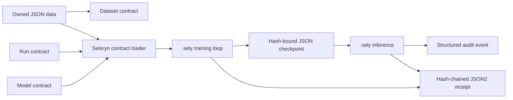

# Auditable local inference proof

This is the first product-shaped proof of Seloryn's proposed niche: a local AI
workflow whose data, model, checkpoint and runtime contracts are explicit and
machine-checked before a result is accepted.

The fixture is deliberately small so its behavior is inspectable. It contains
an owned binary equipment-health dataset, a four-input/four-hidden-unit ReLU
MLP, mean-squared error, source-owned reverse-mode updates, holdout evaluation,
JSON checkpoint persistence, reload and a separate inference request. The
network and training loop are written in `.sely`; the runtime supplies tensor
and autodiff primitives, not a predefined trainer.

## Reproduction gate

```powershell
cargo build --release --locked
python tests/auditable_local_inference_probe.py
```

The probe uses a temporary copy of the project and checks all of the following:

| Gate | Required fact | Result from the first proof run |
|---|---|---|
| Static validation | The project passes `seloryn check` | exit `0` |
| Source ownership | No `train_mlp`, `predict_mlp`, `train_linear_gpu` or `load_checkpoint` appears in `.sely` source | pass |
| Training | Loss decreases for 320 source-owned SGD steps | `0.12042054 → 0.04675742` |
| Evaluation | Reloaded checkpoint reaches the holdout target | loss `0.03375852`, accuracy `1.0` |
| Persistence | Checkpoint contains 25 weights and a SHA-256 payload hash | pass; `f164a947…776fc` |
| Inference | A second request loads the checkpoint and returns a decision | `review`, score `1.15945053` |
| Streaming | Training and inference receipts verify independently | `23` and `3` events; both valid |
| Audit event | Inference emits structured model/decision/checkpoint evidence | one `audit.record` event |
| Negative boundaries | Wrong feature order/count, dataset shape/target, model contract and checkpoint tampering fail | all six exit `65` |

The exact wall time is not a product claim. On the first local run, the
Seloryn process took `0.2596 s` and the independent pure-Python reference took
`0.0225 s` for this tiny fixture. That result is useful because it exposes the
current overhead; it is not evidence that Seloryn is faster. The next
performance gate is to profile process startup, tensor allocation and the
training loop separately before changing the semantics.

## Independent numerical comparison

The reference in
[`examples/projects/auditable-local-inference/baseline/reference.py`](../../examples/projects/auditable-local-inference/baseline/reference.py)
uses only Python's standard library. It reimplements the same matrix
operations, ReLU, MSE derivatives and SGD equations without importing Seloryn
or calling a training helper.

| Backend | Initial loss | Final loss | Test loss | Accuracy | Interpretation |
|---|---:|---:|---:|---:|---|
| Seloryn `.sely` | 0.12042054 | 0.04675742 | 0.03375852 | 1.000000 | executable source-owned workflow |
| Python pure reference | 0.12042056 | 0.04675742 | 0.03375852 | 1.000000 | independent correctness oracle |

The probe accepts a loss difference below `1e-4` and exact accuracy equality.
The small initial-loss difference is expected from Seloryn's `F32` tensors;
the final and holdout values agree within the gate.

## Workflow boundary



This is a verified preview, not a stable ABI or a general model ecosystem. It
does not claim transformer training, GPU tensor training, distributed runs,
HTTP serving, package publication or production-ready runtime status.
