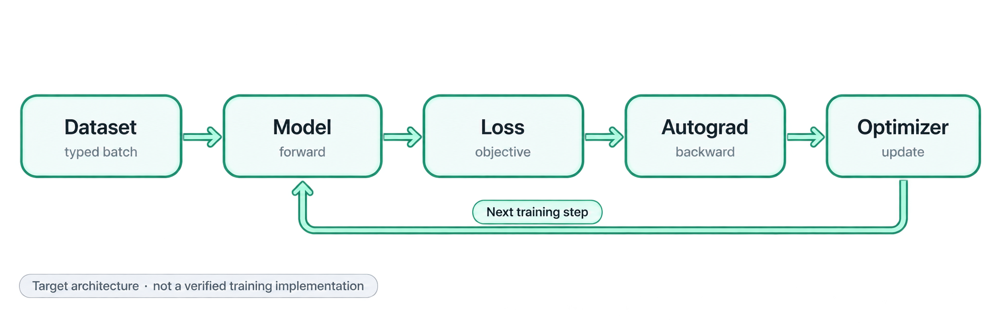

# Automatic differentiation

**General reverse-mode autodiff remains a design target:** Seloryn now contains
an executable N3a scalar reverse-mode tape and an N3b bounded CPU Tensor[F32]
reverse-mode tape. F32/F64 annotations are accepted, but the current `Value` representation
uses F64 for scalars and does not claim an independent F32 rounding contract. It records scalar operations, accumulates shared parents, supports
helper calls, simple conditions and constant-exponent powers, and fails
explicitly for unsupported constructs. `gradcheck` independently compares the
tape derivative with a finite-difference estimate. The tensor gate traces one
Tensor[F32] input and a rank-zero Tensor[F32] objective. This is not a GPU
graph, optimizer or general training engine.

The first ML-ready gradient engine is still intended to use **reverse-mode
automatic differentiation** over an explicit computation graph, with leaf
parameters, intermediate values, saved tensors and one derivative rule per
differentiable primitive.



### Target semantics

```seloryn
using tape = GradientTape():
    let output = model.forward(batch.inputs)
    let loss = mean_squared_error(output, batch.targets)
let gradients = tape.backward(loss)?
optimizer.apply(gradients)?
```

`using` is reserved grammar pending an ownership/cancellation design. This
example describes the intended tensor API only; it is not executable.

### Executable scalar check

The current scalar gate is executable and builds a reverse tape:

```seloryn
from autograd import gradcheck

fn f(x: F32) -> F32:
    return x * x + x

fn main() -> F32:
    return gradcheck(f, 4.0)
```

`seloryn run` returns `9.0` for this source. `backward(f, 4.0)` returns the
same analytic derivative without the finite-difference comparison. The tape
implementation is in [`src/compute/autograd.rs`](../../src/compute/autograd.rs), the runtime
bridge is in [`src/runtime/mod.rs`](../../src/runtime/mod.rs), and the independent
black-box proof is [`tests/n3_probe.py`](../../tests/n3_probe.py). Tensor
`backward` now builds and executes a real bounded reverse tape. The
[`tensor-gradient.sely`](../../examples/autograd/tensor-gradient.sely) example
propagates through `matmul`, elementwise multiplication and `tensor_mean`.
The tensor rules cover broadcasting, reductions, matrix multiplication,
transpose, reshape, ReLU, exp, log, softmax, log-sum-exp and
`tensor_sum_to_shape`.

The N3a boundary is deliberately small: scalar `+`, `-`, `*`, `/`, unary
negation, constant-exponent `**`, helper calls, comparisons used by simple
conditions, and `require`. The N3b tensor boundary is one F32 tensor input,
pure tensor expressions and a rank-zero output; loops, `match`, variable
exponents, multiple differentiated inputs and higher-order derivatives are
rejected or remain future work.

### Required derivation tests

1. Scalar and vector finite-difference checks (bounded numeric tolerance).
2. Broadcast-reduction gradient shape inversion, including summed broadcast axes.
3. Matrix-multiplication transposed gradient and batched gradients.
4. Zero-sized axes, NaN/Inf, accumulation dtype and mixed precision correctness.
5. Graph reuse rules, in-place operation invalidation, detached tensors, no-grad scopes.
6. Gradient checkpoint recomputation with identical semantics.
7. Backward error propagation without leaked buffers.

Forward-mode/JVP and higher-order differentiation can be added only after the
reverse-mode contract holds. GPU derivatives must match CPU semantics within
published tolerances and supported dtype coverage.
