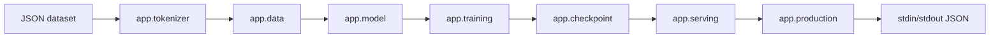

# Executable language-model proof

Seloryn now has one complete, bounded next-token workflow authored in `.sely`.
It is a 14-token bigram softmax model trained on an owned dataset. The model is
small by design, but the path is real: source modules load data, compute a
cross-entropy objective, request reverse-mode gradients, update weights with
SGD, evaluate held-out pairs, persist a JSON checkpoint with SHA-256 metadata,
reload it and answer a second CLI request.

## Project tree

```text
self-hosted-language-model/
├── seloryn.toml
├── data/
│   ├── train.json
│   └── test.json
├── checkpoints/
│   └── .gitkeep
└── src/
    ├── self-hosted-language-model-entry.sely
    └── app/
        ├── checkpoint.sely
        ├── data.sely
        ├── model.sely
        ├── production.sely
        ├── serving.sely
        ├── tokenizer.sely
        └── training.sely
```

The import graph is intentionally ordinary Seloryn modules:



There is no call to a predefined `train_mlp`, `train_linear` or prediction
function in the project source. The runtime provides tensor primitives and the
`gradients` primitive; the architecture, objective, loop, evaluation,
serialization and inference orchestration are `.sely` code.

## Reproduction

From the repository root, build the release binary and run the black-box proof:

```powershell
cargo build --release --locked
python tests/self_hosted_language_model_probe.py
python tests/compare_language_model.py
```

The proof also executes negative paths for an unknown token and a mismatched
prompt count. Training emits 160 `training.progress` events inside a 162-event
hash-chained JSON2 receipt. The final checkpoint is loaded by a fresh inference
process, not read from the training object in memory.

## Measured comparison

The reference uses the same 14x14 full-batch bigram and the same 160 updates in
Python's standard library. This is a correctness comparison, not a performance
claim: the current interpreter has higher host overhead on this tiny workload.

| implementation | initial loss | final loss | held-out loss | accuracy | generation | wall time |
|---|---:|---:|---:|---:|---|---:|
| Python stdlib | 2.639057330 | 0.829485686 | 1.532877856 | 0.533333 | `the park <eos>` | 0.027022 s |
| Seloryn `.sely` | 2.639058590 | 0.829485893 | 1.532878041 | 0.533333 | `the park <eos>` | 1.133476 s |

The exact wall time varies by machine. The acceptance invariant is numerical:
final-loss and held-out-loss differences are below `1e-5`, and accuracy is
equal. The model's fixed vocabulary, one-token context and project-defined
tensor dimensions are deliberate boundaries; the checkpoint does not revalidate
dataset files during inference. This is not a transformer, Unicode tokenizer,
GPU trainer, HTTP server or stable production runtime.

The complete hashes, exit codes and receipt details are recorded beside the
project in [`evidence.md`](../../examples/projects/self-hosted-language-model/evidence.md).
