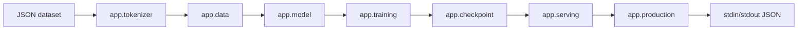

# Executable language-model proof

Seloryn now has one complete, bounded next-token workflow authored in `.sely`.
The baseline fixture is a 14-token bigram softmax model trained on an owned
dataset. The path is real: source modules load `vocab.json` and token datasets,
derive tensor dimensions, compute fused cross-entropy, request reverse-mode
gradients, update named parameters with reusable SGD, evaluate held-out pairs,
persist a JSON checkpoint with SHA-256 metadata, reload it and answer a second
CLI request. The same source also passes a five-token vocabulary variant.

## Project tree

```text
self-hosted-language-model/
├── seloryn.toml
├── data/
│   ├── vocab.json
│   ├── train.json
│   └── test.json
├── checkpoints/
│   └── .gitkeep
└── src/
    ├── self-hosted-language-model-entry.sely
    └── app/
        ├── checkpoint.sely
        ├── data.sely
        ├── model.sely
        ├── optim.sely
        ├── parameters.sely
        ├── production.sely
        ├── serving.sely
        ├── tokenizer.sely
        └── training.sely
```

The import graph is intentionally ordinary Seloryn modules:



There is no call to a predefined `train_mlp`, `train_linear` or prediction
function in the project source. The runtime provides tensor primitives, fused
cross-entropy and the `gradients` primitive; the architecture, objective, loop,
evaluation, serialization and inference orchestration are `.sely` code.

## Reproduction

From the repository root, build the release binary and run the black-box proof:

```powershell
cargo build --release --locked
python tests/self_hosted_language_model_probe.py
python tests/compare_language_model.py
```

The proof also executes negative paths for an unknown token, malformed dataset
and mismatched prompt count. It then copies the project, changes the vocabulary
to five tokens and trains that variant without source changes. Training emits 21
sampled `training.progress` events inside a 23-event hash-chained JSON2 receipt.
The final checkpoint is loaded by a fresh inference process, not read from the
training object in memory.

## Measured comparison

The reference loads the same vocabulary and datasets, then uses the same 14x14
full-batch bigram and 160 updates in Python's standard library. This is a
correctness comparison. After fused cross-entropy and sampled loss evaluation,
three cold process runs measured 0.1704–0.1760 s for Python and 0.7902–0.9004 s
for Seloryn on this Windows host; process and filesystem noise is material at
this size.

| implementation | initial loss | final loss | held-out loss | accuracy | generation | wall time |
|---|---:|---:|---:|---:|---|---:|
| Python stdlib | 2.639057330 | 0.829485686 | 1.532877856 | 0.533333 | `the park <eos>` | 0.173277 s median |
| Seloryn `.sely` | 2.639057398 | 0.829485774 | 1.532877922 | 0.533333 | `the park <eos>` | 0.810498 s median |

The exact wall time varies by machine. The acceptance invariant is numerical:
final-loss and held-out-loss differences are below `1e-5`, and accuracy is
equal. The model's one-token context is a deliberate boundary; vocabulary and
tensor dimensions are no longer fixed in source. The checkpoint does not
revalidate dataset files during inference. This is not a transformer, Unicode tokenizer,
GPU trainer, HTTP server or stable production runtime.

The complete hashes, exit codes and receipt details are recorded beside the
project in [`evidence.md`](../../examples/projects/self-hosted-language-model/evidence.md).
