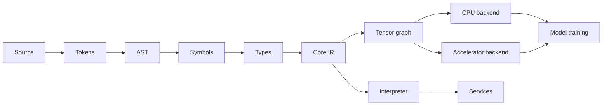

# Architecture

The architecture is defined by owned language semantics from UTF-8 source to deterministic results. The first implementation uses a native systems-language host, but `.sely` is not a wrapper or source-to-source alias for any host language. Verified, established system libraries may be called through constrained interfaces; security-sensitive protocols and cryptography must not be casually reimplemented.

### Subsystems

| Component | Responsibility | Contract |
|---|---|---|
| Front end | UTF-8 scanning, block tokens, recovery parser, source spans | No successful execution of malformed input |
| Semantic core | Name binding, type constraints, exhaustiveness, fallibility, borrowing/ownership checks if adopted | Diagnosable, stable semantics |
| Core IR | Typed operations, flow effects, optimization boundaries | Stable internal dialect, not a user API |
| Execution | Evaluator first; optimizing lowerings later | Deterministic feature-specific behavior |
| Tensor engine | Data buffers, dtypes, shapes, graph, autodiff | Shape/precision/alias correctness |
| Device interface | CPU first, accelerator providers in stages | No implied universal GPU compatibility |
| System library | Streams, HTTP, files, subprocesses | Typed errors and explicit privileges |
| Product tools | CLI, packages, formatter, LSP, installer | Platform-specific measured support |

### Capability sequencing

The public syntactic API of a future feature is only *accepted* once the underlying behavior is implemented, tested and versioned. Language syntax cannot be considered an alternative for working matrix multiplication, reverse-mode autodiff or performant kernels. [Tensors](../compute/tensors.md) → [autograd](../compute/autograd.md) → [training](../compute/training.md) → [LLMs](../compute/llms.md).
