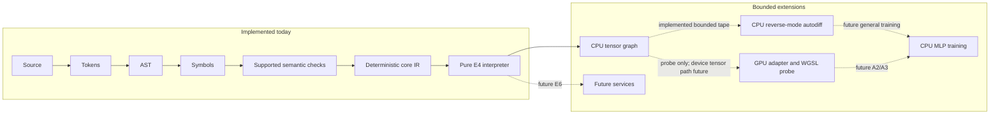

# Architecture

The architecture is defined by owned language semantics from UTF-8 source to deterministic results. **Today the front-end checker, deterministic core IR, bounded pure interpreter, N1/N2 CPU tensor runtime, Seloryn-authored optimization loop and bounded MLP trainer are implemented experimentally/verified as marked in the status table.** The runtime also has a separate hardware-adapter and compute/readback gate. The first implementation uses a native systems-language host, but `.sely` is not a wrapper or source-to-source alias for any host language. Verified, established system libraries may be called through constrained interfaces; security-sensitive protocols and cryptography must not be casually reimplemented. [Status](status.md) is the current evidence boundary.

Legend: **✓ implemented** means the checker/interpreter has source and tests; **⚠️ partial** means a bounded subset exists; **✗ not implemented** means the diagram is a design dependency only. The core IR is experimental and structural; services and device-resident tensor training remain ✗. N1/N2, the autodiff tape, MLP and GPU probe are bounded contracts, not a full ML platform.

### Subsystems

| Component | Responsibility | Contract |
|---|---|---|
| Front end | UTF-8 scanning, block tokens, recovery parser, source spans | No successful execution of malformed input |
| Semantic core | **⚠️ Partial:** name binding, scalar type constraints, exhaustiveness and fallibility checks | Diagnosable static behavior; no runtime execution |
| Core IR | **⚠️ Experimental implemented:** deterministic lowered execution representation | Type checking remains a preceding gate; optimization and SSA passes are future work |
| Execution | **⚠️ Experimental E4/N1/N2:** IR interpreter plus CPU tensor builtins | No broad effects or accelerators |
| Tensor engine | **⚠️ Experimental N1/N2:** owned F32/I64 CPU buffers, checked shapes, broadcasting, reductions, rank-2 matmul, shape/stride transpose views, F32 unary/stable reductions and broadcast sum-to-shape with bounded resident memory | No symbolic shapes or device movement; bounded autodiff is a separate CPU tape |
| Device interface | **⚠️ Probe only:** adapter enumeration and one physical non-fallback WGSL compute/readback path | No device-resident tensors, autodiff parity or GPU training |
| System library | **⚠️ Narrow:** local project modules and bounded JSON reads | HTTP, subprocesses and unrestricted files require later gates |
| Product tools | **⚠️ Partial:** development CLI, experimental build/exec, bounded parser-backed `lsp --stdio`, VS Code extension LSP client/release workflow and local installer scripts | Indexed analysis, formatter and supported runtime distribution are future |

### Capability sequencing

The public syntactic API of a future feature is only *accepted* once the underlying behavior is implemented, tested and versioned. Language syntax cannot be considered an alternative for working matrix multiplication, reverse-mode autodiff or performant kernels. The current training profile is intentionally concrete; the next numerical dependencies after it are reusable optimizer/data APIs, a device-neutral tensor contract and then [LLMs](../compute/llms.md).
