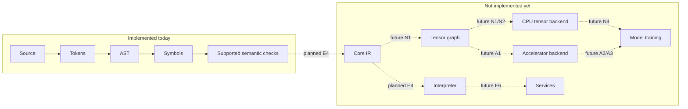

# Architecture

The architecture is defined by owned language semantics from UTF-8 source to deterministic results. **Today only the front-end checker path is implemented.** The first implementation uses a native systems-language host, but `.sely` is not a wrapper or source-to-source alias for any host language. Verified, established system libraries may be called through constrained interfaces; security-sensitive protocols and cryptography must not be casually reimplemented. The attached `seloryn_e3_design_review.md` describes the target architecture; [status](status.md) is the current evidence boundary.

Legend: **✓ implemented** means the checker has source and tests; **⚠️ partial** means a bounded static subset exists; **✗ not implemented** means the diagram is a design dependency only. `Core IR`, interpreter, tensors, services and training are currently ✗.

### Subsystems

| Component | Responsibility | Contract |
|---|---|---|
| Front end | UTF-8 scanning, block tokens, recovery parser, source spans | No successful execution of malformed input |
| Semantic core | **⚠️ Partial:** name binding, scalar type constraints, exhaustiveness and fallibility checks | Diagnosable static behavior; no runtime execution |
| Core IR | **✗ Not implemented** | Typed operations and optimization remain design work |
| Execution | **✗ Not implemented** | E4 must prove a deterministic interpreter |
| Tensor engine | **✗ Not implemented** | Data buffers, dtypes, shapes, graph and autodiff remain design work |
| Device interface | **✗ Not implemented** | CPU and accelerator providers require later evidence |
| System library | **✗ Not implemented** | Streams, HTTP, files and subprocesses require later gates |
| Product tools | **⚠️ Partial:** development CLI only; packages, formatter, LSP and installer are future | Platform-specific measured support |

### Capability sequencing

The public syntactic API of a future feature is only *accepted* once the underlying behavior is implemented, tested and versioned. Language syntax cannot be considered an alternative for working matrix multiplication, reverse-mode autodiff or performant kernels. The next executable dependency is E4, followed by [tensors](../compute/tensors.md) → [autograd](../compute/autograd.md) → [training](../compute/training.md) → [LLMs](../compute/llms.md).
